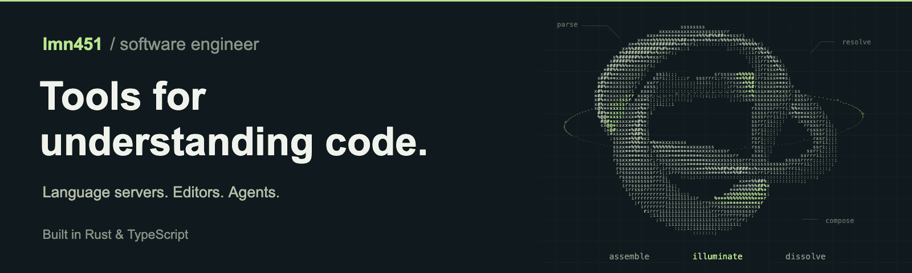

  <picture>
    <source media="(prefers-reduced-motion: reduce)" srcset="./assets/banner-static.png" />
    
  </picture>

[View static banner](./assets/banner-static.png)

# Make unfamiliar code feel navigable.

I'm **lmn451**, a senior software engineer building tools that help developers and coding agents understand large codebases and change them with confidence.

My work connects **language intelligence**, **editor experience**, and **observable agent workflows**, primarily in **Rust and TypeScript**.

**[subagentura.tech](https://subagentura.tech)** · **[Get in touch](mailto:hello@subagentura.tech)** · [All repositories](https://github.com/lmn451?tab=repositories)

---

## From a question to the code that answers it

**01 / Language intelligence**

## CSS Variables Tooling

**A custom property should be traceable beyond the file you're editing.**

CSS variables cross stylesheets, components, and framework boundaries. I maintain a connected toolchain that makes them discoverable across the workspace, from a native language server to Zed and VS Code integrations.

- **Understand:** completions, hover, and diagnostics.
- **Navigate and change:** definitions, references, rename, and color tools.
- **Run where you work:** a native Rust server without a Node.js requirement, plus a TypeScript implementation for portable and fallback environments.

Supports CSS, HTML, JavaScript/TypeScript, Vue, Svelte, Astro, and more.

[Install for Zed](https://zed.dev/extensions/css-variables) · [Install for VS Code](https://marketplace.visualstudio.com/items?itemName=miclmn451.css-variables-vscode) · [Read the Rust source](https://github.com/lmn451/css-lsp-rust) · [npm](https://www.npmjs.com/package/css-variable-lsp)

---

**02 / Agent infrastructure**

## pi-subagentura

**Delegate the work. Keep sight of the execution.**

Multi-agent work shouldn't mean losing the thread. pi-subagentura gives the Pi coding agent reusable workflows and visible child sessions, keeping intermediate results out of the parent context while making the work inspectable.

- **Compose:** sequential, parallel, and pipelined workflows in the background.
- **Observe:** watch, attach to, and continue child sessions in tmux or Zellij.
- **Reuse:** save review, research, migration, and conversion workflows across projects.

[Explore the project](https://subagentura.tech) · [Read the source](https://github.com/lmn451/pi-subagentura) · [npm](https://www.npmjs.com/package/pi-subagentura)

---

**03 / Recording workflows**

## Screencast / ScreenSilo

**Record the walkthrough. Keep the file yours.**

A local-first browser recorder for capturing a tab, window, or screen without an account or upload service.

- **Capture:** choose the surface and optional audio for your walkthrough.
- **Keep control:** recordings stay in browser storage, with recovery and diagnostics tools.
- **Share on your terms:** preview locally and download a WebM file.

[Explore Screencast](https://subagentura.tech/screencast/) · [Read the source](https://github.com/lmn451/screencast)

---

## Also on the workbench

| Project | What it helps you do |
| :--- | :--- |
| **[Git Search for VS Code](https://marketplace.visualstudio.com/items?itemName=lmn451.git-log-s)** | Search commit history, paginate results, and jump to remote commits. [Source](https://github.com/lmn451/git-search) |
| **[JSX Prop Lookup](https://www.npmjs.com/package/jsx-prop-lookup-mcp-server)** | AST-based component prop analysis for React and TypeScript through MCP. [Source](https://github.com/lmn451/jsx-prop-lookup-mcp-server) |
| **[Smart Life Webapp](https://smart-life-webapp.pages.dev)** | Control Smart Life devices through an installable Vue PWA and a region-aware Cloudflare API proxy. [Source](https://github.com/lmn451/smart-life-webapp) |

## Let's build tools people rely on.

I'm open to opportunities in **developer infrastructure, editors, and AI tooling**.

If you're working on making complex software easier to understand and change, I'd like to hear about it.

**[hello@subagentura.tech](mailto:hello@subagentura.tech)** · [Portfolio](https://subagentura.tech)
