  

# lmn451 · Software engineering

I'm a **senior software engineer** working in **Rust and TypeScript**. I build language servers, editor integrations, and tools for inspecting coding-agent workflows. My focus is practical: finding the right code, understanding its connections, and keeping changes observable.

**[subagentura.tech](https://subagentura.tech)** · **[Get in touch](mailto:hello@subagentura.tech)** · [All repositories](https://github.com/lmn451?tab=repositories)

## CSS Variables Tooling

Custom properties cross stylesheets and component boundaries. I maintain a **workspace-aware language server** with Zed and VS Code integrations, bringing completions, hover, diagnostics, definitions, references, rename, and color tools to CSS, HTML, JavaScript/TypeScript, Vue, Svelte, and Astro. The native Rust server needs no Node.js runtime; a TypeScript implementation supports portable and fallback environments.

[Install for Zed](https://zed.dev/extensions/css-variables) · [Install for VS Code](https://marketplace.visualstudio.com/items?itemName=miclmn451.css-variables-vscode) · [Read the Rust source](https://github.com/lmn451/css-lsp-rust) · [npm](https://www.npmjs.com/package/css-variable-lsp)

## pi-subagentura

Delegated work can be difficult to follow. pi-subagentura gives the Pi coding agent **reusable workflows and inspectable child sessions**, keeping intermediate results out of the parent context. Sequential, parallel, and pipelined workflows run in the background; tmux or Zellij lets you watch, attach to, and continue sessions. Review, research, migration, and conversion workflows can carry across projects.

[Explore the project](https://subagentura.tech) · [Read the source](https://github.com/lmn451/pi-subagentura) · [npm](https://www.npmjs.com/package/pi-subagentura)

## Screencast / ScreenSilo

A walkthrough shouldn't require an account or upload service. Screencast is a **local-first browser recorder** for tabs, windows, or screens, with optional audio. Recordings stay in browser storage, supported by recovery and diagnostics tools. You can preview locally and download a WebM file, choosing when and where to share it.

[Explore Screencast](https://subagentura.tech/screencast/) · [Read the source](https://github.com/lmn451/screencast)

## Smaller projects

- **[Git Search for VS Code](https://marketplace.visualstudio.com/items?itemName=lmn451.git-log-s)**: commit-history search and remote navigation. [Source](https://github.com/lmn451/git-search)
- **[JSX Prop Lookup](https://www.npmjs.com/package/jsx-prop-lookup-mcp-server)**: AST-based React/TypeScript prop analysis through MCP. [Source](https://github.com/lmn451/jsx-prop-lookup-mcp-server)
- **[Smart Life Webapp](https://smart-life-webapp.pages.dev)**: device control through a Vue PWA and region-aware Cloudflare proxy. [Source](https://github.com/lmn451/smart-life-webapp)

**Open to opportunities** in developer infrastructure, editors, and AI tooling.

**[hello@subagentura.tech](mailto:hello@subagentura.tech)** · [Portfolio](https://subagentura.tech)
